# OFDM Image Communication System

**Vahab Khalili · VKHS · Sole project author**

A documented, reproducible investigation of image transmission over orthogonal frequency-division multiplexing (OFDM), with **QPSK, 16-PSK, 16-QAM**, 16/32/64-point FFT/IFFT, serial radix-2 transform architecture, cyclic-prefix framing, I/Q signal paths, finite-precision effects, AWGN and image reconstruction.

> **Evidence labels:** `VERIFIED` means executed in the independent numerical reference; `ARCHIVED` means preserved in the original MATLAB/Simulink study (not automatically rerun); `DESIGN` identifies a mathematical or architectural specification; `HARDWARE-SCREENSHOT` is not a reproducible FPGA build.

## Visual overview: Lena transmitted through the OFDM network

The images below are **original saved outputs from this project**, not synthetic distortions generated for the README. Their visible corruption reflects the specific archived simulation paths; the standalone images are from different runs, so they are **not** presented as an SNR-calibrated sequence.

### System block diagram

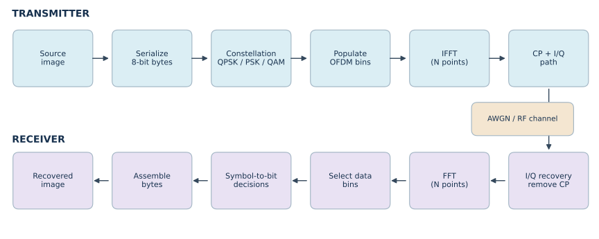

**Signal flow.** Image bytes are serialized and mapped to QPSK/16-PSK/16-QAM constellation symbols. The transmitter populates frequency bins, performs an IFFT and adds framing/I-Q processing where configured. After channel impairment, the receiver reverses the I/Q and OFDM operations, detects the transmitted symbols and reconstructs the image. The [streaming FFT implementation](docs/STREAMING_FFT.md) replaces the abstract transform with scheduled butterflies, delays and twiddle factors.

### Original Lena — recovered images at visibly different degradation levels

<table>
<tr>
<th width="25%">Original input</th>
<th width="25%">Relatively mild corruption</th>
<th width="25%">Severe corruption</th>
<th width="25%">Near-complete loss</th>
</tr>
<tr>
<td align="center"><a href="assets/input_images/lenna.png"></a></td>
<td align="center"><a href="figures/historical/image_outputs/set_01_lena_out_004.jpg">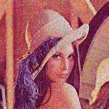</a></td>
<td align="center"><a href="figures/historical/image_outputs/set_01_lena_out.jpg">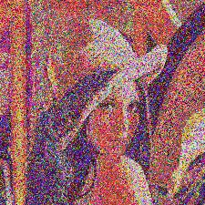</a></td>
<td align="center"><a href="figures/historical/image_outputs/set_02_lena_out.jpg">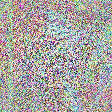</a></td>
</tr>
<tr>
<td align="center"><sub>Uncorrupted reference image</sub></td>
<td align="center"><sub>Archived reconstruction; details remain clearly recognizable</sub></td>
<td align="center"><sub>Archived reconstruction; widespread pixel corruption</sub></td>
<td align="center"><sub>Archived receiver output; content largely obscured by noise</sub></td>
</tr>
</table>

**Additional original received images** — each thumbnail links to its full-resolution archived file:

<table>
<tr>
<th width="25%">Recovered image A</th>
<th width="25%">Recovered image B</th>
<th width="25%">Recovered image C</th>
<th width="25%">Recovered image D</th>
</tr>
<tr>
<td align="center"><a href="figures/historical/image_outputs/set_02_lena1.jpg">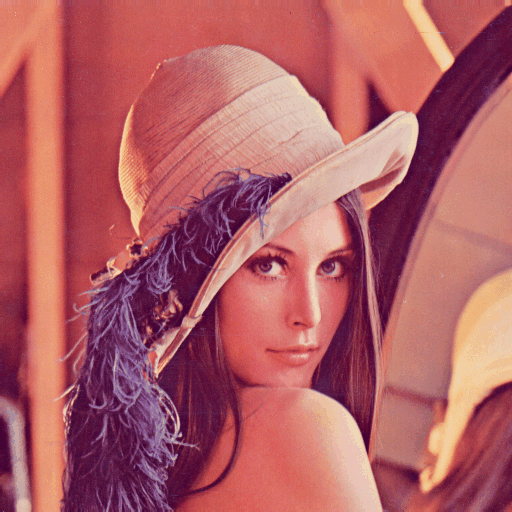</a></td>
<td align="center"><a href="figures/historical/image_outputs/set_01_lena_out_006.jpg">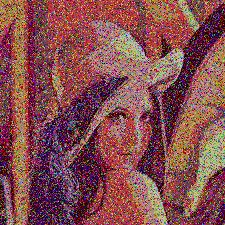</a></td>
<td align="center"><a href="figures/historical/image_outputs/set_02_denajoon.jpg">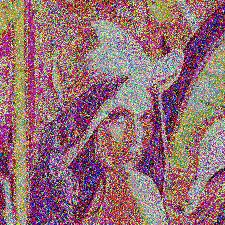</a></td>
<td align="center"><a href="figures/historical/image_outputs/set_02_lenajoon.jpg">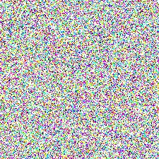</a></td>
</tr>
<tr><td align="center"><sub>Recognizable recovery</sub></td><td align="center"><sub>Dense noise and loss of fine details</sub></td><td align="center"><sub>Strong color-channel corruption</sub></td><td align="center"><sub>Near-total visual loss</sub></td></tr>
</table>

**Interpretation:** the first gallery shows the *appearance* of the archived outputs. It is not an ordered result of changing just one parameter: the individual standalone files do not all encode their SNR, transform length and modulation in their filenames. For parameter-labeled comparisons, use the original MATLAB figure panels below.

### Original MATLAB output panels: 16-QAM, 16-point transform

These saved figures show the **transmitted constellation**, **received constellation**, **input Lena** and **recovered Lena** together. The SNR values are **nominal labels from the archived experiment**, not independently recalibrated SNR measurements.

| Nominal SNR = 0 dB | Nominal SNR = 10 dB |
|:---:|:---:|
| [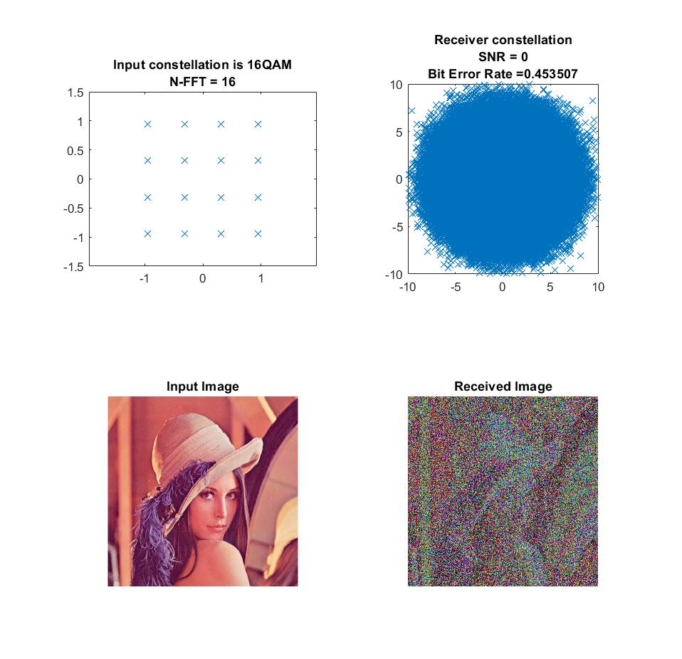](figures/historical/image_outputs/result_16QAM-SNR0-N16.jpg) | [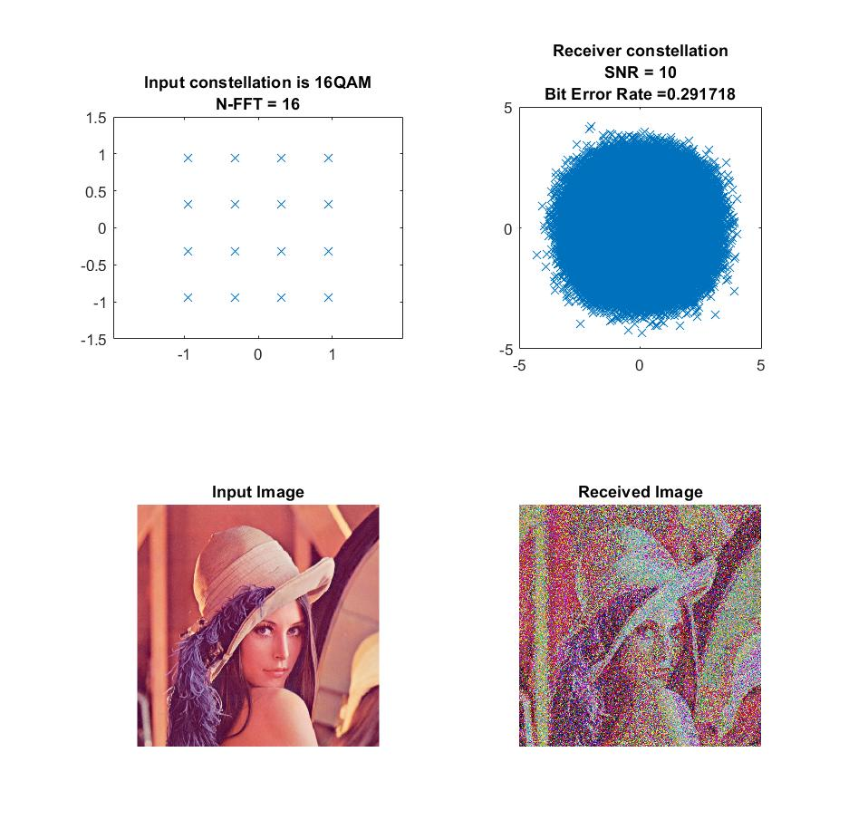](figures/historical/image_outputs/result_16QAM-SNR10-N16.jpg) |
| **Strong signal corruption**: constellation points spread and Lena becomes difficult to recognize. | **Significant corruption**: recognizable structure begins to emerge despite many erroneous pixels. |
| Nominal SNR = 20 dB | Nominal SNR = 30 dB |
| [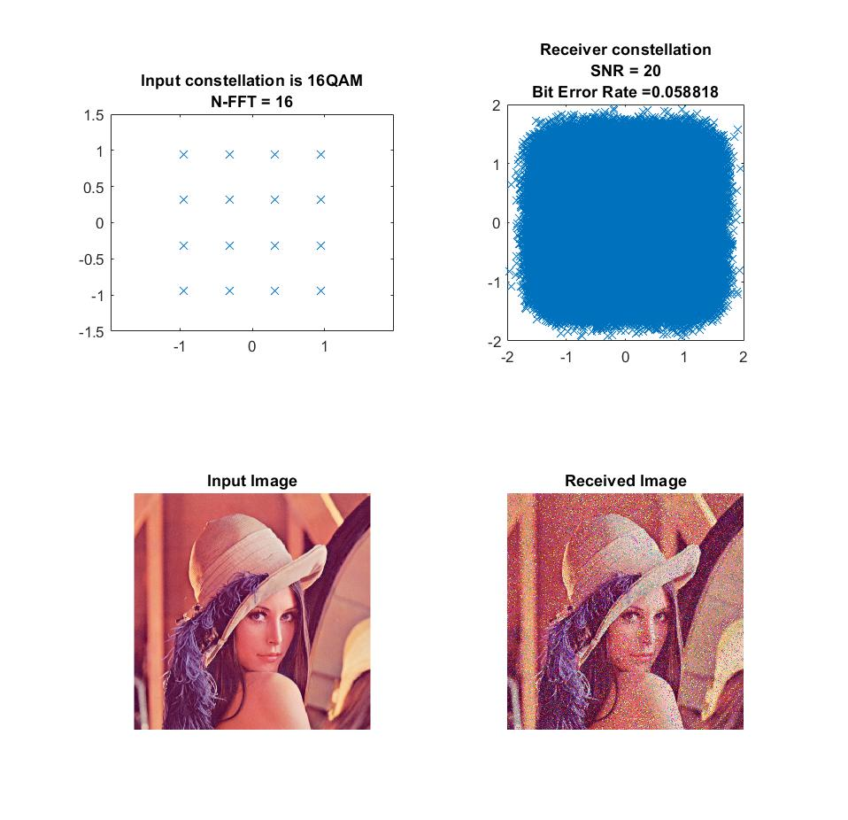](figures/historical/image_outputs/result_16QAM-SNR20-N16.jpg) | [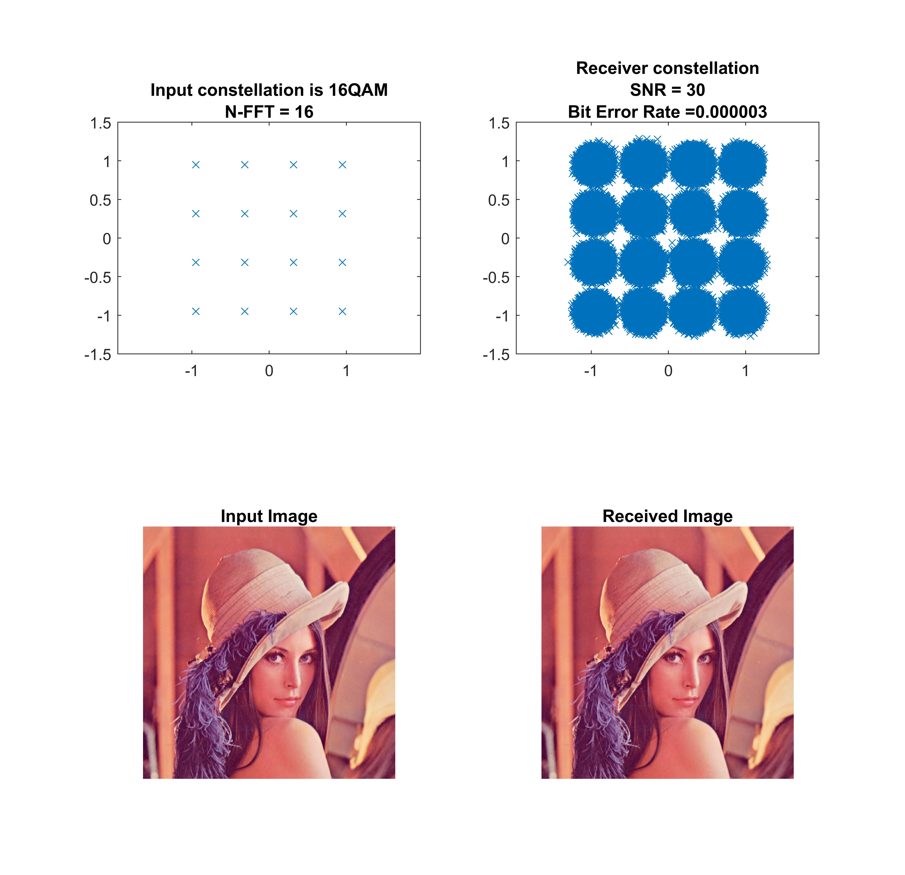](figures/historical/image_outputs/result_16QAM-SNR30-N16.jpg) |
| **Improved recovery**: substantially fewer visible errors than in the lower-SNR saved figures. | **High-fidelity recovery** in the saved example; the received constellation clusters more tightly. |

### Same nominal setting, different modulation formats

The following archived panels use **FFT length 16 and a nominal SNR label of 15 dB**. They illustrate constellation-dependent recovery, but should **not** be treated as a normalized modulation benchmark where source-bit representation and signal power differ between historical models.

| QPSK · N = 16 | 16-PSK · N = 16 | 16-QAM · N = 16 |
|:---:|:---:|:---:|
| [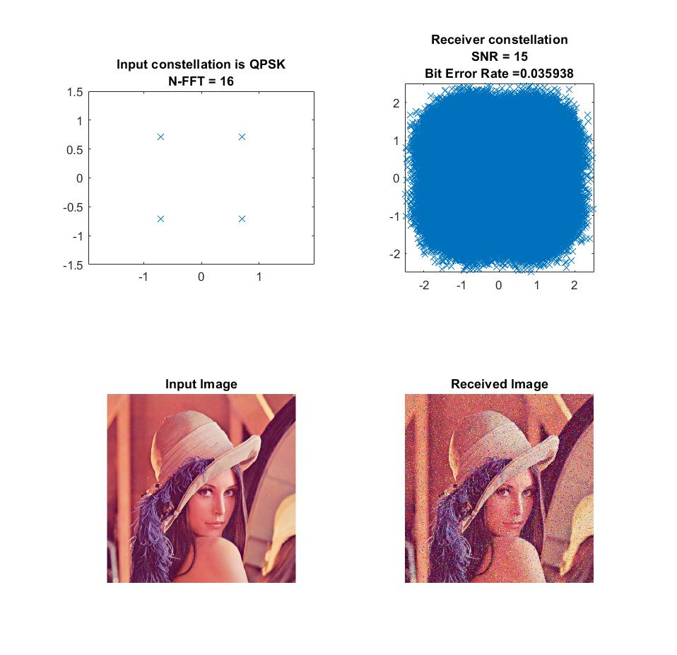](figures/historical/image_outputs/result_QPSK-SNR15-N16.jpg) | [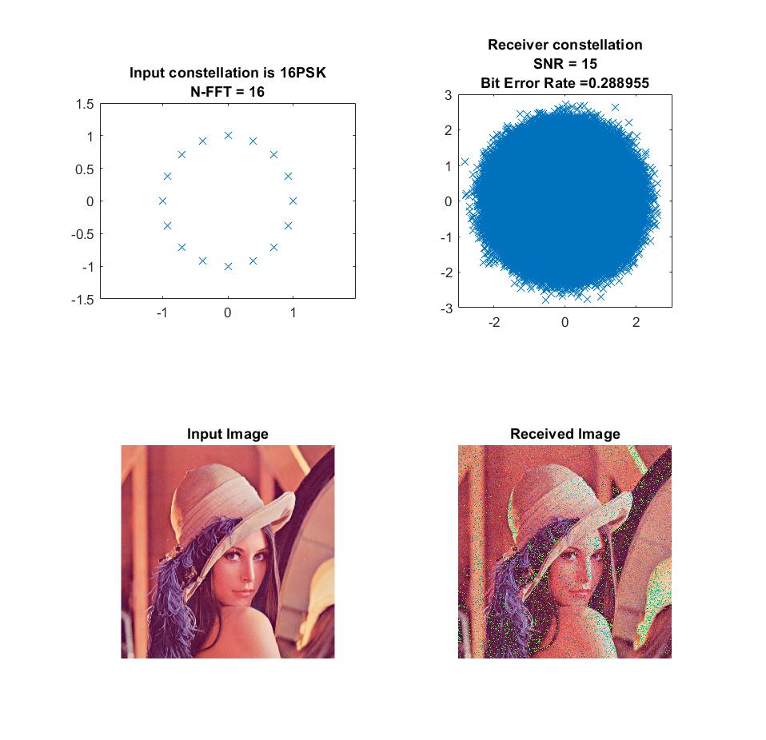](figures/historical/image_outputs/result_16PSK-SNR15-N16.jpg) | [](figures/historical/image_outputs/result_16QAM-SNR15-N16.jpg) |
| 2 mapped bits per symbol | 4 mapped bits per symbol | 4 mapped bits per symbol |

### Transform hardware and quantitative results

| Streaming FFT/IFFT pipeline | Original BER-versus-SNR figure |
|:---:|:---:|
| [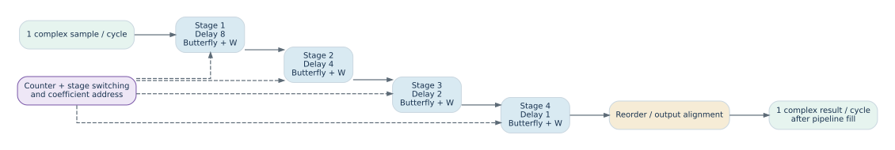](figures/new_design/F03_serial_fft_pipeline.svg) | [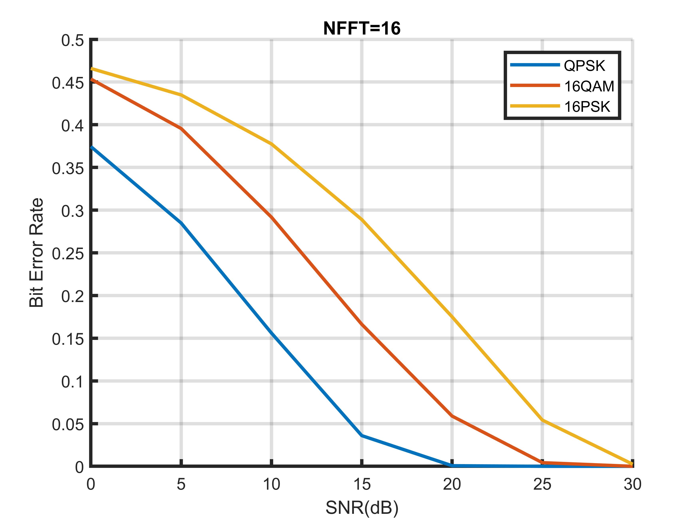](figures/historical/image_outputs/result_BER_nfft_16.jpg) |
| Radix-2 streaming architecture: timed butterflies, delay storage, coefficients and output order. | Original reported BER curves; see [experimental limitations](docs/EXPERIMENTS.md). |

**Explore all original results:** [80 archived image/BER figures with FFT and SNR scenario links](docs/HISTORICAL_RESULTS.md) · [All 13 design figure groups](figures/new_design) · [MATLAB source code](matlab) · [Original Simulink model archive](archive/archived_simulink_models.zip) · [Reproducibility and evidence notes](docs/EVIDENCE.md).

---

## Start here

1. Read the [full system architecture](docs/ARCHITECTURE.md), [signal mathematics](docs/MATHEMATICS.md), and [serial FFT hardware](docs/STREAMING_FFT.md).
2. Install the **only runtime dependency**: `python -m pip install -r requirements.txt`.
3. Run the fast validation: `python -m unittest discover -s tests -v`.
4. Run the representative simulation: `python -m ofdm_image.cli --modulation 16QAM --nfft 64 --snr 12 --output results/example.json`.
5. Inspect the [scenario catalog](docs/SCENARIOS.md) and [evidence register](docs/EVIDENCE.md).

## Four design domains

| Domain | Main functions |
|---|---|
| Image and symbol representation | RGB/grayscale bytes, bit packing, reversible modulation, optional lossy source quantization |
| OFDM / FFT / hardware | Subcarrier placement, inverse/forward FFT, 16/32/64-point radix-2, stream delays and butterflies |
| Transmission channel | Cyclic prefix, complex baseband, optional I/Q-RF conversion, AWGN, ADC/DAC precision and clipping |
| Reconstruction and verification | Carrier decisions, bit/byte recovery, BER, EVM, image reconstruction, latency alignment |

## Scenarios

| Scenario | Modulation | Transform | Evidence |
|---|---|---|---|
| Reversible, noise-free image link | QPSK / 16-QAM / 16-PSK | 16 / 32 / 64 | **VERIFIED** by Python smoke tests |
| Seeded AWGN | QPSK / 16-QAM / 16-PSK | 16 / 32 / 64 | **VERIFIED** in reference code |
| Cyclic prefix / 48 active bins | QPSK / 16-QAM / 16-PSK | 64 | **VERIFIED** numerical framing; **ARCHIVED** Simulink model family |
| 12/14/16-bit finite precision | QPSK / 16-QAM | 16 / 32 / 64 | **ARCHIVED** selected Simulink cases; optional numerical quantizer |
| Serial radix-2 FFT/IFFT scheduling | Multiple | 16 / 32 / 64 | **DESIGN**, **ARCHIVED** Simulink |
| RF I/Q up/downconversion | Multiple | Variable | **ARCHIVED** MATLAB simulation |
| Supplementary 256-QAM | 256-QAM | Prototype | **ARCHIVED**, not part of verified core |
| 16-point FPGA FFT resources | FFT component | 16 | **HARDWARE-SCREENSHOT**, not a complete FPGA transceiver |

The numerical reference intentionally holds source bits and measured waveform SNR constant across modulation comparisons; source quantization and FFT-size/power normalization are treated separately. See [experiment design](docs/EXPERIMENTS.md).

## Figures

The original saved figures are now **committed to GitHub**. See the [80-image historic gallery](docs/HISTORICAL_RESULTS.md), [13 numbered new design diagrams](figures/new_design), [numerical-reference BER/EVM plots](figures/reference_results), [original MATLAB scripts](matlab/legacy), [original model ZIP](archive/archived_simulink_models.zip), [six ZIPs of 155 archived report figures](archive), and [the full figure index](figures/ARCHIVED_FIGURE_INDEX.csv). The historical results were preserved, not rerun.

### Run MATLAB simulations and produce figures

```matlab
addpath('matlab');
test_smoke();
T = run_full_suite('assets/input_images/lenna.png','results/matlab');
```

This new MATLAB sweep saves **63 image reconstructions**, a BER/EVM CSV, BER plots and a comparison gallery. Original historical scripts are available separately in [matlab/legacy](matlab/legacy).

## Repository organization

```text
ofdm_image/         Standalone Python mathematical reference
tests/              Fast unit and integration smoke tests
docs/               Mathematics, architecture, scenarios, hardware, experiments
figures/            GitHub-renderable editable SVG diagrams
.github/workflows/   Automated smoke tests
requirements.txt     Python dependencies
pyproject.toml       Package metadata
```

## Authorship

**Original design and project ownership: Vahab Khalili.** This consolidated repository is maintained under VKHS. Automated commits, code conversion, and documentation formatting are not statements about authorship. No historical assignment recipients are credited in the project narrative.

## Scope

No HDL source, complete FPGA bitstream, measured board power, physical RF capture, or end-to-end post-route FPGA timing report is represented as available. MATLAB/Simulink archives require their own licenses and tool versions. For rigorous interpretation, see [limitations](docs/EVIDENCE.md).
