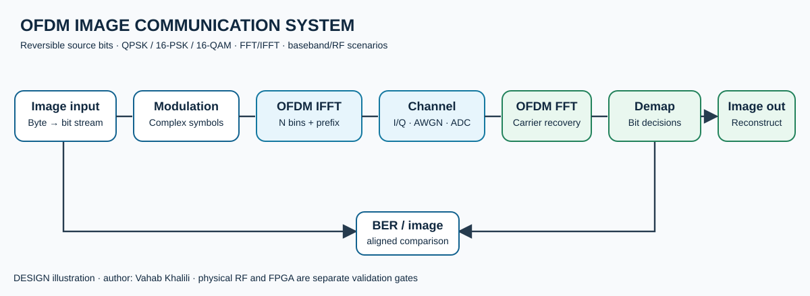

# OFDM Image Communication System

**Vahab Khalili · VKHS · Sole project author**

A documented, reproducible investigation of image transmission over orthogonal frequency-division multiplexing (OFDM), with **QPSK, 16-PSK, 16-QAM**, 16/32/64-point FFT/IFFT, serial radix-2 transform architecture, cyclic-prefix framing, I/Q signal paths, finite-precision effects, AWGN and image reconstruction.

> **Evidence labels:** `VERIFIED` means executed in the independent numerical reference; `ARCHIVED` means preserved in the original MATLAB/Simulink study (not automatically rerun); `DESIGN` identifies a mathematical or architectural specification; `HARDWARE-SCREENSHOT` is not a reproducible FPGA build.



## Start here

1. Read the [full system architecture](docs/ARCHITECTURE.md), [signal mathematics](docs/MATHEMATICS.md), and [serial FFT hardware](docs/STREAMING_FFT.md).
2. Install the **only runtime dependency**: `python -m pip install -r requirements.txt`.
3. Run the fast validation: `python -m unittest discover -s tests -v`.
4. Run the representative simulation: `python -m ofdm_image.cli --modulation 16QAM --nfft 64 --snr 12 --output results/example.json`.
5. Inspect the [scenario catalog](docs/SCENARIOS.md) and [evidence register](docs/EVIDENCE.md).

## Four design domains

| Domain | Main functions |
|---|---|
| Image and symbol representation | RGB/grayscale bytes, bit packing, reversible modulation, optional lossy source quantization |
| OFDM / FFT / hardware | Subcarrier placement, inverse/forward FFT, 16/32/64-point radix-2, stream delays and butterflies |
| Transmission channel | Cyclic prefix, complex baseband, optional I/Q-RF conversion, AWGN, ADC/DAC precision and clipping |
| Reconstruction and verification | Carrier decisions, bit/byte recovery, BER, EVM, image reconstruction, latency alignment |

## Scenarios

| Scenario | Modulation | Transform | Evidence |
|---|---|---|---|
| Reversible, noise-free image link | QPSK / 16-QAM / 16-PSK | 16 / 32 / 64 | **VERIFIED** by Python smoke tests |
| Seeded AWGN | QPSK / 16-QAM / 16-PSK | 16 / 32 / 64 | **VERIFIED** in reference code |
| Cyclic prefix / 48 active bins | QPSK / 16-QAM / 16-PSK | 64 | **VERIFIED** numerical framing; **ARCHIVED** Simulink model family |
| 12/14/16-bit finite precision | QPSK / 16-QAM | 16 / 32 / 64 | **ARCHIVED** selected Simulink cases; optional numerical quantizer |
| Serial radix-2 FFT/IFFT scheduling | Multiple | 16 / 32 / 64 | **DESIGN**, **ARCHIVED** Simulink |
| RF I/Q up/downconversion | Multiple | Variable | **ARCHIVED** MATLAB simulation |
| Supplementary 256-QAM | 256-QAM | Prototype | **ARCHIVED**, not part of verified core |
| 16-point FPGA FFT resources | FFT component | 16 | **HARDWARE-SCREENSHOT**, not a complete FPGA transceiver |

The numerical reference intentionally holds source bits and measured waveform SNR constant across modulation comparisons; source quantization and FFT-size/power normalization are treated separately. See [experiment design](docs/EXPERIMENTS.md).

## Figures

The [figure index](figures/README.md) links to editable vector schematics and describes the historical plots. Original high-resolution MATLAB/Simulink plots, output images and archived models are available in the consolidated source package supplied separately with this project; **they are not all present in this GitHub tree**. The documentation never treats the archived screenshots as newly reproduced measurements.

## Repository organization

```text
ofdm_image/         Standalone Python mathematical reference
tests/              Fast unit and integration smoke tests
docs/               Mathematics, architecture, scenarios, hardware, experiments
figures/            GitHub-renderable editable SVG diagrams
.github/workflows/   Automated smoke tests
requirements.txt     Python dependencies
pyproject.toml       Package metadata
```

## Authorship

**Original design and project ownership: Vahab Khalili.** This consolidated repository is maintained under VKHS. Automated commits, code conversion, and documentation formatting are not statements about authorship. No historical assignment recipients are credited in the project narrative.

## Scope

No HDL source, complete FPGA bitstream, measured board power, physical RF capture, or end-to-end post-route FPGA timing report is represented as available. MATLAB/Simulink archives require their own licenses and tool versions. For rigorous interpretation, see [limitations](docs/EVIDENCE.md).
