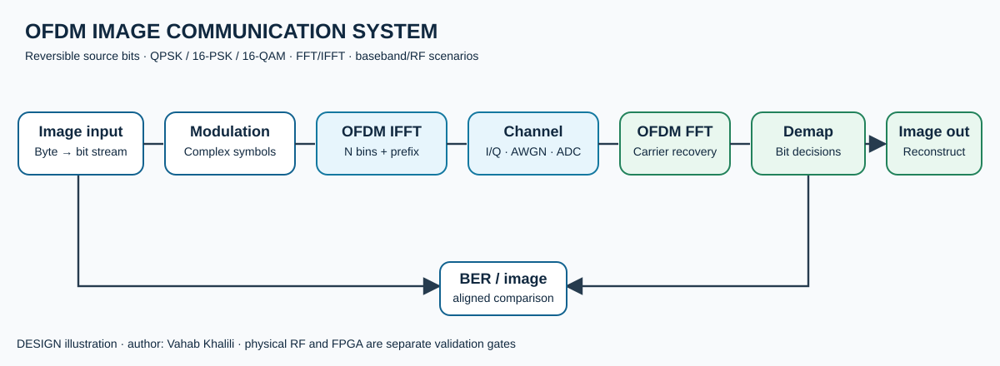
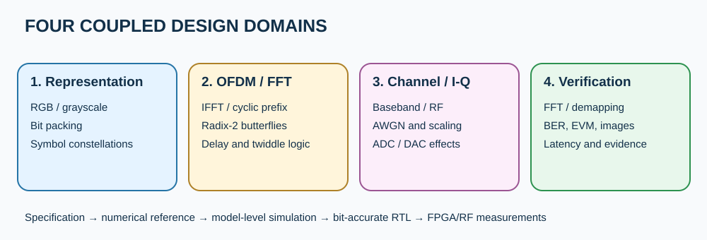

# Complete OFDM image-link architecture

**Author: Vahab Khalili.** This file is the unified specification, not evidence of a single physical prototype.

## 1. Source interface

The source is an 8-bit grayscale or RGB raster. A reversible link converts it to a known byte order, then serializes each byte MSB-first to a bit vector. Preserve the original shape and byte count to reconstruct the image. Optional source quantization must be an explicitly separate scenario, as it irreversibly removes source information.

## 2. Symbol mapping

QPSK maps two bits into a four-point complex constellation. 16-PSK and 16-QAM map four bits into 16 complex constellation points. An indexed, normalized constellation lookup must be inverted consistently by the receiver. Gray labeling affects BER but not the FFT mathematics. The supplementary 256-QAM experiment uses eight bits per symbol.

## 3. Frequency-domain OFDM framing

Map `K` data symbols onto specified subcarrier positions in an `N`-point frequency frame. Unused bins are zero. The numerical reference uses positions 0 through K-1 and does **not** assert DC nulling, Hermitian symmetry or pilot placement. The historical framing design uses N=64, K=48, and 16 zero bins.

## 4. Time-domain synthesis

IFFT converts the occupied subcarrier vector to N time samples, then a cyclic prefix of `L` samples can be copied from the end to the beginning. The 64-point/16-prefix case yields 80 complex samples per OFDM symbol. The block shape and sample order must be recorded.

## 5. Channel choices

The independent reference uses complex-baseband AWGN calibrated to the measured transmitted waveform power. Historical variations also include explicit I/Q conversion to and from an RF waveform, DAC/ADC behavioral models, source rounding, and selected quantized transform values. These are *different* impairment models and cannot be equated without normalization.

## 6. Receiver

Remove the prefix, perform a correctly framed FFT, pick the same K data bins, decide the nearest constellation point, recover bit labels, discard explicitly recorded frame padding, pack bytes and reshape to the original image dimensions.

## 7. Validation

Bit accuracy (BER), constellation RMS error (EVM), image restoration, framing lengths and correct latency alignment are distinct checks. Every waveform-power and Eb/N0 claim requires explicit normalization. Streaming hardware needs valid/ready or otherwise defined sample timing, phase controls, memory delays, twiddle addresses and output reorder.

## Four interacting design domains

## Intended interfaces

| Boundary | Type | Key constraint |
|---|---|---|
| Image → serializer | uint8 raster → uint8 bit vector | Roundtrip byte order |
| Mapper → IFFT | Complex slots, K≤N | Exact carrier map |
| IFFT → channel | Complex N+L samples | Power, CP and timing |
| Receiver → demapper | K recovered complex symbols | Identical symbol labels |
| Bit unpacker → image | Bit stream → RGB/grayscale raster | Remove frame padding |
