# Contents

1. Complete system architecture  
2. Image representation and bit packing  
3. Modulation and constellation geometry  
4. OFDM mathematics and frequency-domain organization  
5. FFT and IFFT architecture  
6. DAC, ADC, quadrature processing and the channel  
7. Receiver reconstruction and evaluation  
8. Project design cases and archived model families  
9. Historical experimental findings  
10. Independent reference experiment and numerical verification  
11. Hardware-oriented interpretation and design boundaries  
12. Recommended project execution sequence  
13. Reproducibility and archive organization  
14. Conclusion

# Executive overview

This document organizes the complete project into one coherent technical specification. Its purpose is to build and evaluate an orthogonal frequency-division multiplexing (OFDM) communication system which transmits image data through a complex-baseband or explicitly modeled quadrature RF channel, reconstructs the image at the receiver, and examines the sensitivity of the link to modulation format, noise, transform size, arithmetic precision, and digital implementation. The architectural focus is the mapping of the fast Fourier transform (FFT) and inverse FFT (IFFT) onto a streaming radix-2 datapath using butterflies, twiddle coefficients, delay storage, switching, output ordering, and latency compensation.

The archive underlying this project contains MATLAB scripts, 42 Simulink/legacy model files, numerical and visual output figures, an extensive hardware-oriented serial-transform treatment, an RF up/downconversion demonstration, an explicit cyclic-prefix OFDM-framing demonstration, and screenshots of a 16-point transform synthesis implementation. These components share the same engineering objective but were not all executed as one unified physical-system experiment. Therefore, the descriptions below distinguish the **intended architecture**, the **settings actually visible in the supplied models**, **historical screenshots/results**, and **newly recomputed reference simulations**.

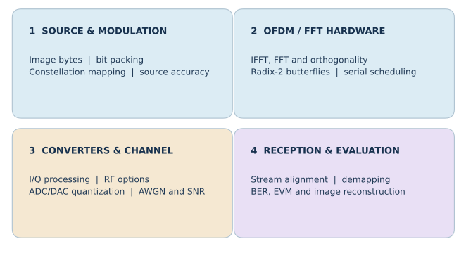{ width=16cm }

**Figure 1.** Four integrated domains: source/modulation, OFDM hardware, converter/channel, and reception/verification.

## Main engineering objectives

1. Represent an image exactly as a sequence of bytes and bits, keeping bit ordering and image dimensions invertible.
2. Compare QPSK, 16-PSK, and 16-QAM (plus a supplementary 256-QAM prototype), without confusing information rate with transform size.
3. Use the IFFT to synthesize orthogonal time-domain subcarriers and the FFT to recover their modulation symbols.
4. Develop a serial radix-2 FFT/IFFT processing path that reuses arithmetic resources through scheduled delays and butterfly operations.
5. Examine channel additive white Gaussian noise (AWGN), converter nonidealities, and finite arithmetic precision, separately wherever possible.
6. Reconstruct the image, evaluate BER and constellation scatter, and distinguish communication errors from lossy source mapping.
7. Trace the design boundary between behavioral simulation, algorithmic equivalence, numerical hardware modeling, and demonstrated synthesized hardware.

# 1. Complete system architecture

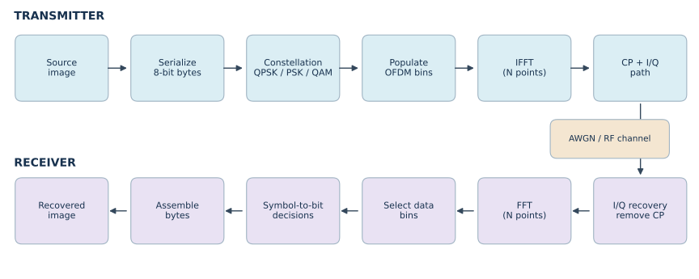{ width=16cm }

**Figure 2.** Complete functional chain. The horizontal overview is provided at full resolution as an SVG/PNG in the figure library; the figure appears at reduced scale here.

The **transmitter** reads the input image, establishes a byte-order convention, serializes the bits, groups them into labels, maps them onto constellation points, forms vectors of $N$ occupied or partially occupied frequency bins, applies an $N$-point IFFT, optionally inserts a cyclic prefix, and passes the resulting complex signal into a baseband or quadrature RF channel model. The **receiver** samples/reconstructs the complex waveform, optionally removes the prefix, forms FFT frames, applies the forward FFT, extracts the occupied carriers, decides the nearest constellation points, converts symbols to bits and image bytes, and reconstructs the original image array. In parallel, a correctly aligned reference stream supports BER measurement.

The archived cases should not be mistaken for one single parameter setting. Some paths use all FFT bins, some use zero padding to 64 bins with 48 occupied, some include a cyclic prefix, and the explicit RF path implements hold-based digital-to-analog representation and coherent mixing. The custom serial FFT is a separate architecture model to the stock vector-based transform models.

## 1.1 Design interfaces and representations

| Interface | Representation | Main invariant |
|:--|:--|:--|
| Image input | $H\times W$ grayscale or $H\times W\times3$ RGB, typically `uint8` | Preserve shape, channel order, and byte count. |
| Serializer output | Binary vector $b[0],\ldots,b[B-1]$ | MSB/LSB convention must match the receiver. |
| Symbol mapper output | $M$-ary complex values $X[k]\in\mathcal C$ | Same lookup and labeling at both ends. |
| IFFT input | $N$ frequency-domain slots per OFDM symbol | Explicitly identify data bins, null bins, and padding. |
| Channel-side signal | Complex baseband samples or real RF waveform | Defined signal power, sample rate, and complex gain. |
| FFT output | Complex values $Y[k]$ | Correct frame position, scaling, ordering, and occupied-bin selection. |
| Demapper output | Estimated bits $\hat b$ | Same bit grouping and padding removal as transmitter. |
| Evaluation | BER, EVM, output image and image metrics | Compare streams at matching sample/bit positions. |

# 2. Image representation and bit packing

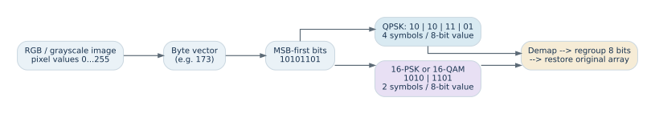

**Figure 3.** Byte-level reversible representation. The example value 173 gives binary `10101101`.

For grayscale pixels, the source information consists of one 8-bit value per pixel. For RGB pixels there are three 8-bit channel values. A $512\times512$ grayscale image contains $2{,}097{,}152$ bits; the same size RGB image contains $6{,}291{,}456$ bits. The smaller $225\times225\times3$ source in some prototype models contains $151{,}875$ channel bytes or $1{,}215{,}000$ bits.

In a truly reversible pipeline, the bytes are serialized to eight bits and those bits are grouped into labels of size $m=\log_2 M$. For QPSK $m=2$, and four symbols carry each byte; for 16-PSK/16-QAM $m=4$, and two symbols carry each byte. If the bits are serialized by bit plane across a column-major image matrix, the receiver must reverse that exact operation rather than assume that the bits of each byte were sent consecutively. MATLAB column-major `reshape`, `(:)`, `dec2bin`, `de2bi`, `bi2de`, and `bin2dec` calls require special care because bit ordering and result orientation can differ between functions.

One class of prototype uses integer division and rounding to make image values directly fit the modulation-label alphabet. For QPSK, a typical pair of operations is $a=\lfloor p/64\rfloor$ and $\hat p=64a$; for 16-point modulation it is $a=\lfloor p/16\rfloor$ and $\hat p=16a$. Those paths discard lower source bits. For example, input 173 becomes 128 in the four-level source-quantized QPSK path, even in a perfectly noiseless channel. Such demonstrations show the combined effects of **lossy source representation** and channel corruption, not pure link BER on identical source information.

**Source-data rule for the consolidated reference:** preserve every original bit for every modulation scheme; use source quantization only as an independently labeled experiment.

# 3. Modulation and constellation geometry

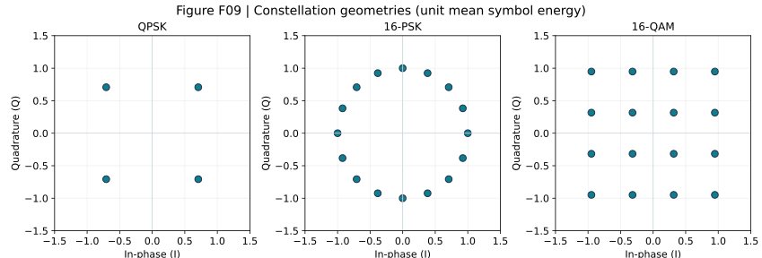

**Figure 4.** Ideal constellation geometries normalized to unit mean symbol energy. Their labeling and normalization must be fixed before BER comparison.

The modulator converts each label $a$ into one complex symbol $X(a)=I(a)+jQ(a)$. The complex representation is native to the FFT/IFFT and to quadrature radio processing.

**QPSK** has four points, carries two bits per symbol, and places successive points 90 degrees apart. It is often the most noise-robust choice among the listed schemes at comparable normalized bit conditions, while having lower information density per modulated symbol.

**16-PSK** has 16 points on a circle and carries four bits per symbol:

$$X_k=\sqrt{E_s}\exp\!\left(j\frac{2\pi k}{16}+j\phi_0\right),\quad k\in\{0,\ldots,15\}.$$

Here $\phi_0$ is a phase offset. (In practical code the exponent is $j(2\pi k/16+\phi_0)$.) Neighboring points are separated by 22.5 degrees. The phase offset is **not** the angular spacing.

**16-QAM** has 16 points in two amplitude dimensions, carries four bits per symbol, and may use unnormalized coordinates $I,Q\in\{-3,-1,+1,+3\}$. For unit mean energy the square 16-QAM constellation is divided by $\sqrt{10}$. At equal average symbol energy its minimum Euclidean distance generally gives superior noise performance to circular 16-PSK.

A supplementary **256-QAM** prototype treats each source byte as a label for one of 256 complex symbols. It does not have the same noise margin as the three primary cases; comparisons must state the bit energy and bandwidth assumptions.

For a coherent hard-decision receiver, the nearest-neighbor rule is:

$$\hat a=\underset{a\in\{0,\dots,M-1\}}{\arg\min}\,|Y-X(a)|^2.$$

The symbol-to-bit labeling must invert the transmitter lookup. The newly generated reference implementation uses explicit reproducible maps; the archived models retain their original configured symbol mappings.

# 4. OFDM mathematics and frequency-domain organization

For a full $N$-point complex OFDM symbol, define subcarrier coefficients $X[0],\dots,X[N-1]$. The time-domain waveform is:

$$x[n]=\frac1N\sum_{k=0}^{N-1}X[k]e^{j2\pi kn/N},\qquad 0\le n<N.$$

The receiver computes:

$$Y[k]=\sum_{n=0}^{N-1}r[n]e^{-j2\pi kn/N}.$$

In an ideal aligned, noise-free channel with matching normalization, $\operatorname{FFT}(\operatorname{IFFT}(X))=X$ to numerical precision. Thus the IFFT/FFT pair replaces an explicit bank of complex sinusoidal modulators and demodulators.

Orthogonality follows from

$$\sum_{n=0}^{N-1}e^{j2\pi(k-\ell)n/N}=0\quad\text{for integer }k\ne\ell.$$

With useful-symbol sample rate $F_s$, the subcarrier spacing is $\Delta f=F_s/N$ and useful-symbol time is $T_u=N/F_s$. Increasing transform size $N$ at fixed sample rate increases useful-symbol duration and decreases subcarrier spacing; the choice also changes transform depth, state storage, I/O buffering, and latency.

**Important distinction:** a “16-point FFT” refers to transform size $N=16$; “16-QAM” refers to alphabet size $M=16$. They are independent axes of the design space.

## 4.1 Occupied bins and unused bins

One archived framing design uses $N=64$ with 48 occupied data slots and 16 zero slots. It groups data symbols into 48-row frames, pads or inserts null bins to 64, and then applies the 64-point IFFT. The positions of null carriers are part of the communication specification: transmitter bin allocation and receiver extraction must agree.

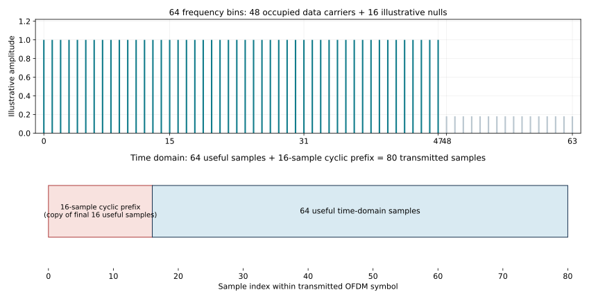

**Figure 5.** A representative 48/64 carrier arrangement and a 16/64 prefix. The occupancy drawing is illustrative of counts rather than a claim about every archived bin-placement convention.

## 4.2 Cyclic prefix

Given a useful time-domain symbol $x[0],\ldots,x[N-1]$ and prefix length $L_{cp}$, transmit

$$x_{cp}=[x[N-L_{cp}],\ldots,x[N-1],x[0],\ldots,x[N-1]].$$

A $64$-point symbol with $L_{cp}=16$ transmits $80$ complex sample positions. The extra time-domain samples are redundant: they facilitate circular-convolution behavior when a multipath delay spread fits within the prefix and time/frequency synchronization is adequate. They do not by themselves improve BER on a purely flat AWGN channel.

The explicit framing archive works with 960 bits per input frame. For QPSK: 960 bits $\to480$ symbols $\to10$ groups of 48 data carriers $\to10$ frames of 64 frequency bins $\to10$ blocks of 80 transmitted complex samples. For 16-PSK/16-QAM: 960 bits $\to240$ symbols $\to5$ groups of 48 $\to5$ frames of 64 $\to5$ blocks of 80. These dimensions must be maintained through framing and de-framing.

# 5. FFT and IFFT architecture

## 5.1 Computational cost and butterfly decomposition

A direct length-$N$ DFT requires order $N^2$ complex operations. A radix-2 FFT factorizes the problem into $\log_2N$ stages with order $N\log_2N$ work. For the available FFT sizes, stage counts are:

| FFT length $N$ | Radix-2 stages | Successive conceptual feedback-delay depths | Delay sum |
|---:|---:|:--|---:|
| 16 | 4 | 8, 4, 2, 1 | 15 |
| 32 | 5 | 16, 8, 4, 2, 1 | 31 |
| 64 | 6 | 32, 16, 8, 4, 2, 1 | 63 |

The basic DIF-style radix-2 butterfly uses two complex values $a$ and $b$:

$$u=a+b,\qquad v=(a-b)W_N^k,\qquad W_N^k=e^{-j2\pi k/N}.$$

The placement of twiddle multiplication differs across equivalent FFT flow-graph variants. What matters is that the stage schedule, coefficient sequence, and output permutation implement the same DFT.

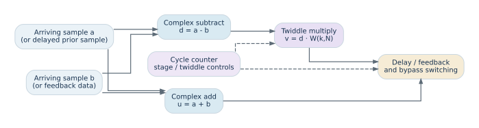

**Figure 6.** The arithmetic/control separation of one radix-2 butterfly processing stage.

## 5.2 Serial processing, data dependencies, and delays

A vector FFT can access all $N$ inputs at once. A serial FFT receives one complex input each clock/sample interval, while each butterfly needs the correct pair from different positions of a transform block. Storage is needed to retain the first operand until its partner arrives.

In a length-16 DIF schedule, the first stage can pair samples separated by 8 positions, the next by 4, then 2, then 1. A single-path delay-feedback (R2SDF) organization reuses arithmetic hardware at each stage and uses memories/switching to alternate between bypassing, combining, and feeding values back. The conceptual stage feedback storage $N/2+N/4+\dots+1=N-1$ counts only stage delays; output reordering, pipeline registers, control, and extra buffering can increase implementation storage.

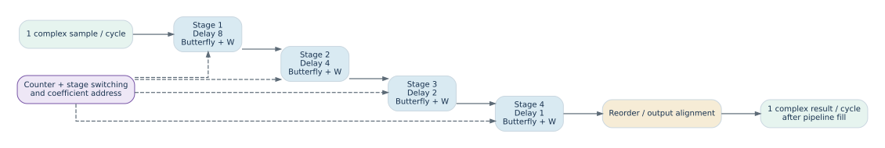

**Figure 7.** A conceptual four-stage length-16 serial FFT pipeline. The one-sample-per-cycle steady-state rate is an architectural possibility after filling the pipeline, not evidence that every archived Simulink variant reaches that rate on physical hardware.

The archived serial Simulink implementations use butterfly subsystems, explicit delays, coefficient control, and output switching. Their overall storage and timing should be evaluated from their actual blocks; they cannot automatically be assigned the minimum memory of an idealized textbook R2SDF core. The exact latency and output-order path must be verified per implementation.

## 5.3 Twiddle-factor generation

Twiddle coefficients are $W_N^k=e^{-j2\pi k/N}$ and can be stored in a coefficient lookup table, generated by a numerically controlled oscillator, or reduced by symmetry. A resource-constrained implementation commonly uses a ROM/lookup table plus shared complex multiplication. The address sequence is driven by the sample position and the FFT stage. Coefficient quantization changes multiplier error and may create systematic transform distortion if coefficients are too coarse.

## 5.4 Output permutation and sample alignment

Many radix-2 flow graphs generate bit-reversed or otherwise permuted output order. For an 8-point example, a possible stream is $[X_0,X_4,X_2,X_6,X_1,X_5,X_3,X_7]$, rather than natural order $[X_0,\ldots,X_7]$. The receiver demapper must use the correct mapping between FFT slots and modulation symbols. A numerically correct butterfly network connected to the wrong carrier order cannot reconstruct the intended bitstream.

The serial archive contains explicit output reordering and reported combined alignment delays. For the illustrated versions, the total reference-versus-receiver delay is 50 sample periods at $N=16$, 106 at $N=32$, and 226 at $N=64$. These figures include an additional converter-path delay of approximately two sample periods in the particular models and are **not** general minimum latencies for R2SDF hardware.

## 5.5 IFFT reuse

An inverse transform can be implemented with a forward FFT:

$$\operatorname{IFFT}(X)=\frac1N\operatorname{conj}\bigl(\operatorname{FFT}(\operatorname{conj}(X))\bigr).$$

This permits shared stage structures and control logic, with input/output conjugation and appropriate $1/N$ normalization. The archived designs use this relationship in the custom serial architectures. Arithmetic sign conventions and coefficient schedules still need separate verification for each mode.

## 5.6 Pipeline control signals

At minimum, a hardware-compatible streaming implementation needs a sample-valid signal, frame boundary or transform-phase counter, butterfly add/subtract/bypass selection, delay memory read/write addressing, twiddle address, output-valid, and an output ordering rule. Frame transitions must be defined so that the last samples of one FFT block are not unintentionally combined with the first samples of the next.

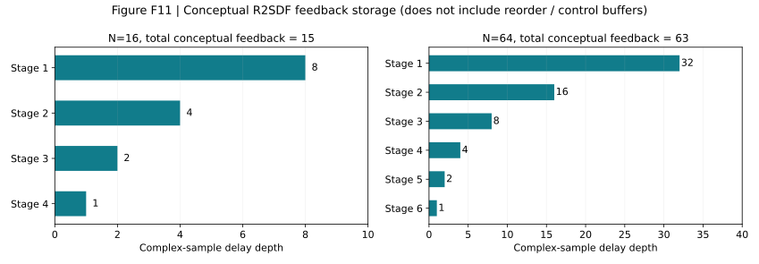

**Figure 8.** Idealized feedback delays for length-16 and length-64 transforms. These do not include all buffers in the archived simulation implementations.

# 6. DAC, ADC, quadrature signal processing and the channel

## 6.1 Complex baseband path

A baseband model treats $x[n]=I[n]+jQ[n]$ as a complex sequence, applies an impairment (for example AWGN), and directly sends the sequence to the FFT. This is computationally efficient and adequate for studying FFT/mapping and many noise effects. It does not model analog carrier generation or physical converters unless such effects are explicitly added.

## 6.2 Explicit quadrature RF path

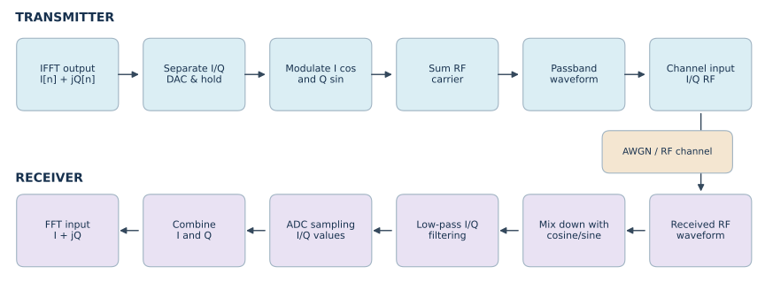{ width=16cm }

**Figure 9.** Explicit digital-to-RF and RF-to-digital signal operations as represented in the archived MATLAB radio-path experiment.

The RF path separates $I$ and $Q$, applies a held-sample DAC approximation, and constructs a real passband signal. In the original sign convention,

$$s(t)=I(t)\cos(2\pi f_ct)+Q(t)\sin(2\pi f_ct).$$

The receiver multiplies the passband signal by coherent cosine and sine waveforms, low-pass filters the products, and samples the recovered components. A factor of approximately two restores the low-pass baseband amplitude in the ideal coherent mixing model. If a negative sine carrier is used instead, the corresponding receiver sign must also be adjusted; the two conventions must not be mixed.

The archived radio-path script specifies carrier frequency $f_c=40$ MHz, a 5 MHz baseband sample-update parameter, sample simulation time $T_s=5$ ns, and a 200 MHz simulation grid. This gives 40 RF-grid points per held baseband sample. These are numerical simulation rates, not FPGA timing results or an external hardware measurement.

## 6.3 Quantization, finite range and nonidealities

A uniform mathematical quantizer may be written as $Q_\Delta(x)=\Delta\operatorname{round}(x/\Delta)$. A real ADC model additionally needs a finite full-scale range, a specified number of output codes, saturation/clipping behavior, and quantizer transfer characteristic. A DAC adds its own transfer, settling, gain and offset characteristics. The I/Q components may need separately modeled converter paths.

Nominal 12-, 14-, and 16-bit cases in one archive use steps $2^{-10}$, $2^{-12}$, and $2^{-14}$ respectively in selected quantizers. These values do **not** establish that every internal butterfly multiplier and register uses bounded fixed-point arithmetic. An implementation-level precision specification must also define the radix-point positions, intermediate products, guard bits, round/truncate mode, overflow/saturation, and stage-by-stage scaling.

OFDM peak-to-average-power ratio can make converter-range selection important. An ADC or DAC sized only for average magnitude may clip occasional waveform peaks, even when quantization step size is small.

## 6.4 Channel AWGN and the meaning of SNR

An additive Gaussian channel is $r[n]=x[n]+w[n]$, with $w$ drawn from a complex normal distribution of the desired variance in complex baseband. For target sample-domain SNR $\gamma$ in linear scale,

$$\sigma_w^2=\frac{\mathbb E|x[n]|^2}{\gamma},\qquad \gamma=10^{\mathrm{SNR_{dB}}/10}.$$

If noise is added to a **real RF** waveform, the power and noise conventions must be adapted accordingly. An AWGN function or block configured with assumed reference signal power rather than measured signal power can produce a large difference between its nominal and actual SNR.

The standard IFFT divides its output by $N$. With all $N$ occupied bins and mean unit subcarrier energy, time-sample average power is $1/N$. With $K$ occupied bins of unit mean energy, time-sample average power is $K/N^2$. Therefore, at constant absolute noise power and fixed subcarrier energy, changing $N$ also changes sample-domain SNR. This must be accounted for before attributing greater error to the FFT size itself.

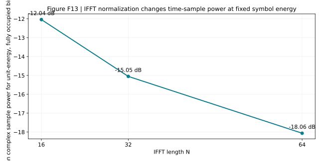

**Figure 10.** At fixed unit-energy occupied symbols, the normalized IFFT output's average power changes as $1/N$ when all bins are occupied.

# 7. Receiver reconstruction and evaluation

## 7.1 Receiver sequence

The receiver must enforce the reverse protocol in this order: sample and recover I/Q, restore consistent complex gain, remove prefix if present, align FFT frame boundaries, FFT the useful $N$ samples, select occupied bins, undo permutations, decide constellation labels, recover bits, remove any pad bits, reconstruct original bytes, reshape to original dimensions, and compare to the transmitted image and bits.

## 7.2 BER, SER, EVM, and image fidelity

**Bit error rate:** $\mathrm{BER}=\bigl(\sum_i[b_i\ne\hat b_i]\bigr)/B$ with both vectors aligned and of the same length. **Symbol error rate:** the number of incorrect constellation-symbol labels divided by transmitted data-symbol count. **Error-vector magnitude:** $\mathrm{EVM}_{rms}=\sqrt{\sum|Y_i-X_i|^2/\sum|X_i|^2}$ after the reference and received symbols have compatible gain, phase, and indexing. **Peak signal-to-noise ratio (image):** $\mathrm{PSNR}=10\log_{10}(255^2/\mathrm{MSE})$ for the reconstructed 8-bit image, with infinite PSNR when image MSE is zero.

Image appearance alone does not uniquely identify BER. Bit significance matters: a flipped most significant source-byte bit changes a pixel by 128, whereas a flipped least significant bit changes it by one. A packet or carrier-index error can also create localized patterns unlike independent random bit errors.

## 7.3 Delay and output validity

One custom serial model reports a 50-sample Tx/Rx alignment delay for $N=16$, 106 for $N=32$, and 226 for $N=64$. After the reference stream is correspondingly delayed, initial pipeline fill and trailing non-payload samples must be discarded before the comparison and image reshaping. The archived reconstruction scripts explicitly crop initial and trailing data. This is an algorithmic and architectural requirement, not a cosmetic plotting detail.

# 8. Project design cases and archived model families

The source archive has been reorganized by model function, rather than by who received the assignment. **There are 42 model files in the consolidated inventory**: 24 vector/serial reference-and-hardware-oriented files in the main transform family, additional transform variants and frame models, and several prototypes or legacy files. The machine-readable inventory contains every available filename; the original model files remain individually openable rather than being merged destructively.

| Family in this project | Purpose | Examples of design choices |
|:--|:--|:--|
| `models/reference_vector/` | Algorithmic parallel FFT/IFFT experiments | QPSK, 16-QAM, 16-PSK; $N=16,32,64$. |
| `models/serial_fft/` | Custom serial transform, delay, coefficient, I/Q and precision experiments | $N=16,32,64$; nominal 12/14/16-bit cases. |
| `models/ofdm_framing/` | Frame-based OFDM with occupied/empty bins and cyclic prefix | 960 input bits, 48 data subcarriers, 64-point IFFT, 16-sample prefix. |
| `models/prototypes/` | Smaller initial modulation and sampling concepts | 225-square input, direct source-level quantization, partial converter and S/H paths. |
| `models/legacy/` | Additional legacy model format if present | Retained separately from the main modern Simulink model family. |

The exact model-to-category assignment is machine-listed in `models/MODEL_INVENTORY.csv`. Some archived prototypes have missing workspace inputs, MATLAB toolbox dependencies, or incomplete converter structures; the package does not claim each can run immediately without corresponding toolboxes and setup.

## 8.1 Reference-vector experiments

These use built-in transform blocks to validate modulation, IFFT/FFT reversal, and image recovery under AWGN. They form a numerical baseline for the custom serial transform. The comparison must keep consistent symbol labels and waveform normalization; the original experiments do not always do so.

## 8.2 Serial transform experiments

These expand butterfly stages explicitly, use coefficient sequences, serial buses and delays, perform output reordering and reference-stream alignment, and examine nominal quantizer settings. The saved model structures are the most detailed evidence of the digital architecture, although they use Simulink numerical datatypes and should not be represented as automatically cycle-accurate verified RTL.

## 8.3 Explicit OFDM framing

The 48/64 occupied-bin framing and 16-sample prefix subsystem explicitly illustrates the framing overhead and the conversion between source bits, modulation symbols, occupied frequency bins, and transmitted time-domain sample blocks.

## 8.4 RF and converter experiments

The explicit RF path uses passband mixing at numerical time-grid resolution and coherent downconversion. Other models contain behavioral DAC/ADC nonidealities, quantization blocks, or preliminary converter attempts. They are not all identical implementations of the same RF front end.

# 9. Historical experimental findings: what is and is not established

## 9.1 Reported SNR sensitivity in the serial 16-QAM path

One archived group of screenshots, for serial 16-QAM with $N=16$ and a nominal 14-bit precision setting, reports:

| Reported SNR | Reported BER |
|---:|---:|
| 10 dB | 0.0584 |
| 13 dB | 0.01727 |
| 16 dB | 0.002459 |

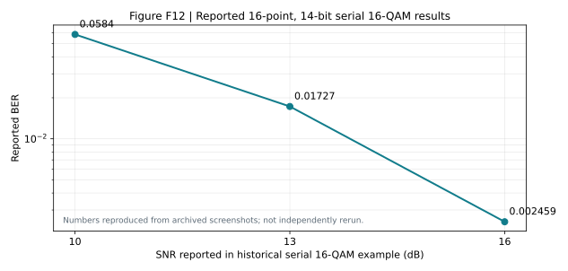

**Figure 11.** Archived numeric BER results plotted afresh for readability. These three values are transcribed from screenshots, not new independent runs.

The monotone decline in BER demonstrates the expected relationship within that simulation configuration. Whether the nominal SNR equals measured waveform SNR must be determined from that model's channel power settings.

## 9.2 Reported precision sensitivity

At 10 dB in a reported serial 16-QAM 16-point case, nominal 12/14/16-bit precision settings give BER approximately 0.0585, 0.0584, and 0.05838 respectively. This small difference shows that the tested link was dominated by other impairments in that parameter regime; it does not prove that a fully fixed-point 12-bit transform is generally optimal.

## 9.3 Interpreting transform-length comparisons

Increasing from $N=16$ to 32 to 64 changes the normalized IFFT sample power for a fixed unit-energy constellation. Some archived comparisons reuse the same absolute AWGN noise power, giving an unintended SNR change. Therefore, those images do not isolate a transform-size disadvantage. A fair transform-length comparison needs equal actual SNR, the same input bits, matching useful occupied bandwidth, and consistent power/energy normalization.

## 9.4 An observed quantizer misconfiguration

One archived quantization experiment describes a nominal 12-bit scale using 4096, but the model's saved gain/quantization settings use gain 8192 and step 620. The effective input-domain step is $620/8192\simeq0.07568$. This is much coarser than a conventionally specified bounded 12-bit converter over a unit range and should not be interpreted as representative 12-bit ADC behavior. The archived model remains preserved for inspection; the main project documents the discrepancy.

## 9.5 What the archived FPGA screenshot supports

An archived implementation screenshot concerns a 16-point FFT component in an ISE design flow targeting `xc3s700an-5fgg484` with a module interface containing clock, start, data, twiddle-address, and stage-control signals. The screenshot reports:

| FPGA component resource | Screenshot value |
|:--|---:|
| Slice flip-flops | 306 |
| Four-input LUTs | 819 |
| Occupied slices | 509 |
| Total four-input LUTs including route-throughs | 838 |
| Bonded I/O blocks | 51 |

The displayed interface uses 24-bit wide complex sample buses and visible 12-bit real/imaginary segments in the illustrated component. The screenshot is evidence of the reported component-level mapping, **not** utilization of the complete radio transmitter and receiver, not timing closure at an identified clock frequency, and not a measured board-level energy or power experiment. No source RTL or ISE project corresponding to that screenshot is present in the supplied archive.

## 9.6 Original experimental figures retained

The figure collection includes all extractable archived document-media graphics and report image objects, standalone example outputs and BER plots, original image samples, and new fully named figure assets. Historical artifacts are retained as evidence of the original assignment design. Their visual quality and measurement setup vary. Image/object-based extraction sometimes yields fragments, repeated screenshots or logos alongside engineering figures, so the organized figure index distinguishes archived material from newly generated explanatory diagrams. No cover-identifying source pages are reproduced in the technical appendices.

# 10. Independent reference experiment and numerical verification

A separate `code/reference_python/run_reference.py` provides a reproducible, toolbox-free **complex-baseband** comparison. It is a newly implemented validation helper: it does not replace the original MATLAB/Simulink projects or pretend to reproduce the unexecuted RF path. It preserves all input image bits across all modulation formats, creates a distinct measured-power AWGN noise realization for each parameter setting, pads and removes whole OFDM frames consistently, optionally adds a cyclic prefix, and applies a deterministic nearest-neighbor demapper.

The reference verifies that **all 9 combinations** of QPSK/16-PSK/16-QAM and FFT length 16/32/64 recover every original bit on a noise-free channel. A seeded sweep generates a CSV of BER and EVM for each combination across sample SNR 4, 8, 12, 16, and 20 dB. The script writes reconstructed images, constellation scatterplots, and curves to `figures/reference_results/`. The test image is an original archived input resized to a documented 128-square verification size for a manageable reference run.

**Figure 12.** Independently recomputed baseband BER curves, with every image bit retained and measured time-domain sample-power normalization. A zero-error estimate is plotted with a finite sample-count floor; the actual BER values including zeros are stored in the CSV file.

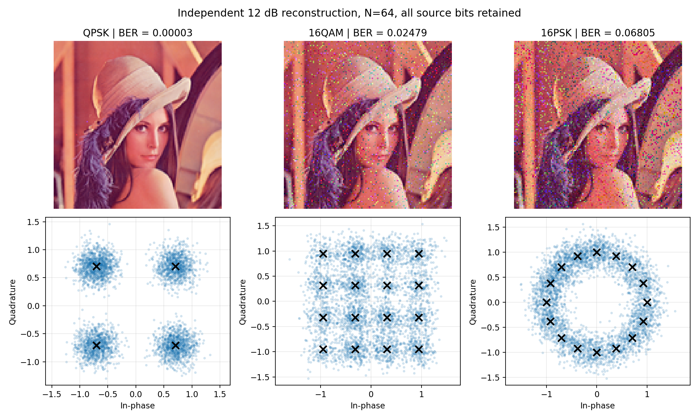

**Figure 13.** Independently computed image recovery and constellation scatter at actual normalized 12 dB sample-domain SNR for a 64-point transform.

Example new reference BER values for $N=64$ at 12 dB are approximately 0.00005086 (QPSK), 0.02477 (16-QAM), and 0.06703 (16-PSK), with equal-length original bitstreams. These are **new simulation values**, not historical values and not physical-device measurements. Exact values are reproducible with the supplied seed and input image.

## 10.1 Design-validation ladder

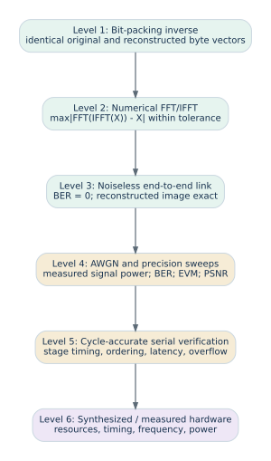{ width=8cm }

**Figure 14.** Verification stages needed to progress from source-bit consistency to credible deployed hardware claims.

1. Check byte-to-bit and bit-to-byte inversion independently of the communication channel.
2. Check transform identity and numerical error with known patterns and random complex vectors.
3. Verify noiseless end-to-end transmission with all image bits retained.
4. Measure actual waveform power and channel noise, then run seeded BER/EVM sweeps.
5. Compare vector and streaming transforms after correcting permutation, pipeline latency and numeric format.
6. Simulate fixed-point overflow, coefficient truncation, converter clipping, and RF gain mismatch as separate effects.
7. Generate actual HDL/netlists and record utilization, timing closure, clock frequency, and system-level power before claiming hardware results.

# 11. Hardware-oriented interpretation and design boundaries

The project's hardware contribution is the architecture of a reusable FFT/IFFT datapath: complex additions/subtractions, twiddle multipliers, line-delay memories, counter-controlled switching, valid tracking, and optional bit-reversal storage. The pipeline trades concurrent processing resources for sequential state and control. A one-sample-per-cycle steady-state streaming implementation is a reasonable architectural target when the chosen design and its clock timing support it, but the archive does not supply end-to-end physical evidence of this operating point.

For implementation planning, assign explicit numerical formats for input samples, twiddle ROM, butterfly sums/differences, products and outputs. Add sufficient growth bits or stage scaling to prevent overflow. Specify whether complex multiplication uses four real multipliers (direct form) or an optimized alternative. Include memory width/depth and control state in the area count. Actual FPGA arithmetic primitives, RAM topology, DSP packing, setup/hold constraints, and achievable clock depend on target device and place-and-route.

The reported 16-point FFT ISE screenshot is retained as **component-level historical evidence only**. It cannot justify claims about whole-system LUT/DSP/BRAM utilization, system throughput, RF performance, ADC/DAC rail power, or measured energy per image unless the rest of the implementation and instrumentation are provided.

**Figure 15.** The distinction between preserved design evidence and claims that need additional hardware verification.

# 12. Recommended project execution sequence

| Step | Input | Work | Output / acceptance criterion |
|---:|:--|:--|:--|
| 1 | Archived input image | Determine dimensions, byte order, serialization convention | Documented source length and exact bit/byte round trip |
| 2 | QPSK/16-PSK/16-QAM mapper | Verify symbol labels, constellation energy and inverse demapping | BER = 0 before OFDM |
| 3 | Vector FFT/IFFT | Validate $N=16,32,64$, frame padding, occupied bins | FFT/IFFT residual at floating-point tolerance |
| 4 | Baseband AWGN | Calculate power from transmitted samples | Actual SNR matches requested target within statistical tolerance |
| 5 | Image receiver | Remove padding, decode, reshape and compare | BER = 0 at noise-free setting; image exact |
| 6 | Serial FFT architecture | Implement butterfly scheduling, twiddle indexing, feedback/reordering | Sample-for-sample match to reference FFT after known latency |
| 7 | Converter path | Specify full-scale and precision; model clipping and rounding | Bounded numerical error and documented overflow behavior |
| 8 | Optional RF path | Use matching mixing convention, filtering and sample-grid timing | Recovered complex gain and phase characterized |
| 9 | OFDM prefix/guard design | Define multipath channel if CP benefit is being tested | Compare with/without CP at equal effective energy conditions |
| 10 | Hardware synthesis | Obtain actual RTL and a target device/project | Reports on LUT/FF/DSP/RAM, timing, latency and actual power method |
| 11 | Final study | Sweep modulation, SNR, FFT length, precision | Reproducible tables, metadata and figures |

# 13. Reproducibility and archive organization

The project is delivered in an organized directory. The root `README.md` provides the launch points. The human-readable source is this Markdown report; PDF and DOCX versions are included. The model inventory CSV provides the exact paths of the 42 retained editable Simulink/legacy models. The `code/legacy_matlab` directory contains archived scripts under neutral identifiers. The `code/reference_python` directory contains independently verified runnable reference code; an additional MATLAB reference can be used without requiring the original Simulink subsystems. `figures/new_design` contains editable DOT and SVG drawings alongside PNG previews, `figures/reference_results` contains newly computed results, and `figures/historical` contains archived plots, screenshot/image extractions, and source-document media. Technical appendices are the original report bodies without identifying cover pages and without the original personal attribution metadata.

**Environment note:** The archive was created with older MATLAB/Simulink versions and contains dependent toolboxes, workspace variables, and models whose initial setup is not consolidated. Files are preserved as evidence, not certified to execute unchanged on any current MATLAB installation. The new Python baseline has been run and checked independently. A hardware RTL tree and a board-measured power log were not supplied and are not fabricated in this package.

## Deliverable inventory

- Detailed master report in Markdown, DOCX and PDF formats.
- 42 archived Simulink or legacy model files with an indexed inventory and identifying metadata cleaned where possible.
- The original available MATLAB scripts, grouped under neutral set IDs, with a separately labeled modern reference script.
- Archived image inputs, reconstruction outputs, RF constellation and BER plots, extracted report images, and document-media figures.
- Conceptual and analytical figures (including independent reference simulations), most available as editable DOT/SVG and print-resolution PNG.
- Independent Python verification code with seeded simulation data and nine passing clean-channel tests.
- Technical appendices excluding original identifying cover pages.
- A reproducibility/limitations note and a figure catalog.

# 14. Conclusion

The central project is a hardware-aware, image-based OFDM communication chain. Its transmitter maps image information to QPSK/PSK/QAM symbols and synthesizes the waveform with an IFFT; its receiver applies the complementary FFT and detection operations to recover the image. The major architectural feature is serial radix-2 transform processing, which requires scheduled butterflies, delay feedback, twiddle addressing, stream reordering, and latency-aware verification. The associated experiment families cover orthogonal-subcarrier framing, explicit I/Q RF conversion, finite precision, AWGN, constellation error, and final image quality.

The organized archive preserves the complete available design evidence and does not conflate demonstration screenshots, reference equations, and actual synthesized or physically measured results. The newly supplied reference validation establishes a clean, reproducible basis from which the archived communication and hardware models can be compared and extended while maintaining correct signal power, source bit count, and stream alignment.
