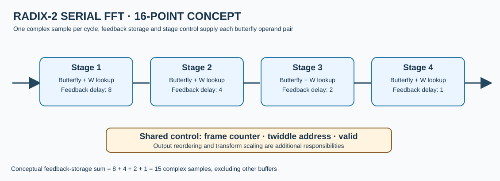

# Streaming radix-2 FFT/IFFT hardware architecture

**Author: Vahab Khalili.**

## The critical hardware problem

A vector FFT operates on all N complex samples as a batch. A stream supplies one sample at a time, so values that must meet at a butterfly often arrive different numbers of cycles apart. An FPGA-oriented architecture must **schedule paired operands** using explicit sample delays, a stage phase counter, twiddle ROM lookup, butterfly mode, feedback paths, and valid/reordering logic.

## Radix-2 butterfly

The schematic DIF butterfly has `u=a+b` and `v=(a-b)*W_N^k`, with `W_N^k=exp(-j2pi k/N)`. The IFFT uses the inverse twiddle sign and an appropriate transform normalization, or the conjugation identity.

## Stages and delay storage

A 16-point radix-2 FFT has 4 stages with conceptual stage-pair separations 8,4,2,1. The corresponding sequences for N=32 are 16,8,4,2,1; for N=64 they are 32,16,8,4,2,1. In an *idealized* R2SDF feedback-storage accounting, these add to N−1 complex samples. Additional registers and output-order storage are not included in that lower-bound-style conceptual count.

## Implementation nuances

1. **Frame boundaries:** no accidental cross-frame pairing; reset/flush phase state explicitly.
2. **Input and output valid:** fixed-cycle latency must include feedback and final permutation.
3. **Twiddle addressing:** indices depend on stage, slot and DIF/DIT convention.
4. **Output order:** some radix-2 schedules produce a bit-reversed permutation; an explicit reorder mechanism or compatible demapper addressing is mandatory.
5. **Scaling:** choose per-stage shifts or expanded widths; 1/N normalization must be applied exactly once in inverse mode.
6. **Fixed point:** document I/Q signed width, coefficient precision, product/accumulation widths, rounding mode and saturation policy.
7. **Verification:** compare complex output vectors and streaming sample/valid traces to numerical FFT reference at each N, using impulse, tone, alternating, random and full-scale cases.

## Status and evidence

The archived Simulink material includes serial-butterfly/delay/switch configurations, but it has not been revalidated in this GitHub CI. The historical simulation alignments include total delays of 50 sample periods (N=16), 106 (N=32), and 226 (N=64) in particular model paths, including converter-delay assumptions. These are **model-specific** alignments, not universal minimum R2SDF latencies.

A historical ISE synthesis screenshot shows a 16-point FFT **component** for `xc3s700an-5fgg484`: 306 slice flip-flops, 819 four-input LUTs, 509 occupied slices, 838 total LUTs including route-through and 51 bonded I/Os. The original HDL, timing constraints and bitstream are not present, so these numbers are labeled screenshot-only, not reproduced synthesis or end-to-end OFDM hardware.

## Next implementation gate

A hardware-verifiable contribution would require: source-controlled RTL, a reference-vector generator, cycle-accurate cocotb/HDL simulation, quantization-aware FFT tolerances, frame-transition assertions, and vendor synthesis/timing reports. The software smoke tests in this repository verify **numerical OFDM**, not such a gate.
